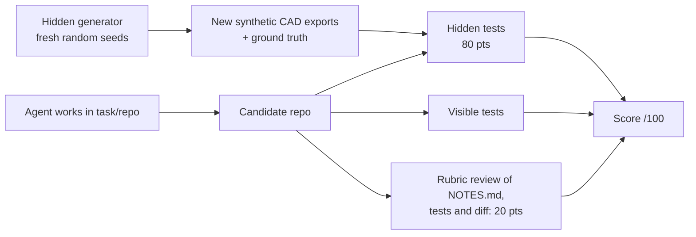

# ems-response-audit-task

[](https://github.com/MOHAMMEDALAHMADI1/ems-response-audit-task/actions/workflows/ci.yml)


**A realistic, multi-bug software-engineering evaluation task for coding agents, set in an ambulance dispatch analytics codebase.**

## Problem statement
Agent benchmarks are saturating on small, self-contained bug fixes. Real engineering failures look different: a KPI
that *improves* after a migration, data that is silently corrupted instead of crashing, and definitions that live in
documentation rather than code. This task packages that kind of failure into a reproducible environment with an
automated, cheat-resistant grader.

The scenario comes from my work as an EMS specialist at the Saudi Red Crescent Authority (since 2012): response-time
reports drive staffing and posting decisions, so a silently wrong KPI has real operational cost.

## The task (what the agent sees)
- [`task/prompt.md`](task/prompt.md): the stakeholder brief.
- [`task/repo/`](task/repo): a small Python analytics codebase (standard library only) that loads two half-year CAD
  exports (different schema versions, encodings and timestamp conventions; Arabic names; Hijri and Gregorian dates) and
  produces a monthly response-time report per district. The visible tests pass.

Leadership has noticed suspicious patterns in the 2025 report. The agent must find the root causes, fix them without
breaking public interfaces, add regression tests, and write up its reasoning in `NOTES.md`.

> Spoiler policy: this README deliberately does **not** list the bugs.

## How it is graded

- **Automated (80 pts):** hidden tests regenerate synthetic data with **unseen seeds** and compare the agent's report
  against ground truth computed from the generator's true incidents, not from the CSVs. Hard-coding values or editing data
  cannot pass. A test scores only if it passes on every seed. Tests also penalise over-correction.
- **Manual / LLM-judge (20 pts):** root-cause analysis quality, regression tests (including boundary cases), minimal
  and readable diff, and honesty about remaining risk.
- **Calibration:** the starting repo scores **18/80** on the automated part and the reference solution **80/80**. Meta-tests
  check both, and also check that a plausible-but-wrong fix is caught.

**The hidden grader, data generator, full rubric and reference solution are intentionally kept private** so the task
stays useful as an eval. They can be shared with reviewers on request.

## Quickstart
```bash
git clone https://github.com/MOHAMMEDALAHMADI1/ems-response-audit-task && cd ems-response-audit-task/task/repo
python -m pytest -q                                  # visible tests (pass on the buggy code)
python -m dispatch.report data --out report.json     # produce the monthly KPI report
```
To run it as an eval, give an agent the `task/` folder only, with the instructions in `task/prompt.md`.

## Design notes
| Property | How |
|---|---|
| Realistic | Mixed schema versions, legacy Windows-1256 export, UTC vs local time, surge-day call patterns, a data dictionary that is the source of truth |
| Hard to shortcut | Fresh seeds at grading time; truth from a generator the agent never sees |
| Partial credit | 11 weighted automated checks plus a 4-criterion rubric |
| Scalable to week-long | Planned extensions: a third schema version with partial backfills, priority-specific KPIs, and a historical-data migration script |

## Limitations
- Single-repo, Python-only, standard library; a real CAD system is far larger.
- The Hijri dates are tabular (arithmetic) and may differ from Umm al-Qura by one day. This is documented in the repo and not graded.
- The manual 20 points need a human or a calibrated LLM judge.

## Roadmap
- [ ] Containerised harness (Docker) with time and tool budgets
- [ ] Week-long variant with a schema v3, backfill job, and dashboard regression
- [ ] Baseline scores for several open and closed coding agents
- [ ] Inter-rater agreement study for the manual rubric

## Data and ethics
All data is **100 % synthetic**: generated names, hashed fake phone numbers, invented incidents. No real patient or
Red Crescent data is used.

## License
MIT © Mohammed Alahmadi

---

## الملخص بالعربية
مهمة تقييم برمجية واقعية لوكلاء الذكاء الاصطناعي: نظام تحليلات لبلاغات الإسعاف (بيانات اصطناعية بالكامل، أسماء عربية وتواريخ هجرية وميلادية) يُنتج تقريراً شهرياً لزمن الاستجابة، وفيه أخطاء خفية تجعل المؤشر يبدو أفضل من الحقيقة. على الوكيل اكتشاف الأسباب الجذرية وإصلاحها مع اختبارات وشرح مكتوب. يتم التصحيح بمُقيِّم مخفي يولّد بيانات جديدة في كل مرة، مع سلّم تقييم يدوي. المُقيِّم والحل المرجعي محفوظان بشكل خاص للحفاظ على نزاهة التقييم.
